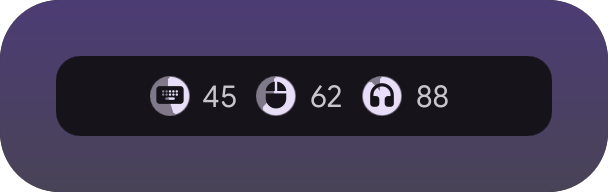
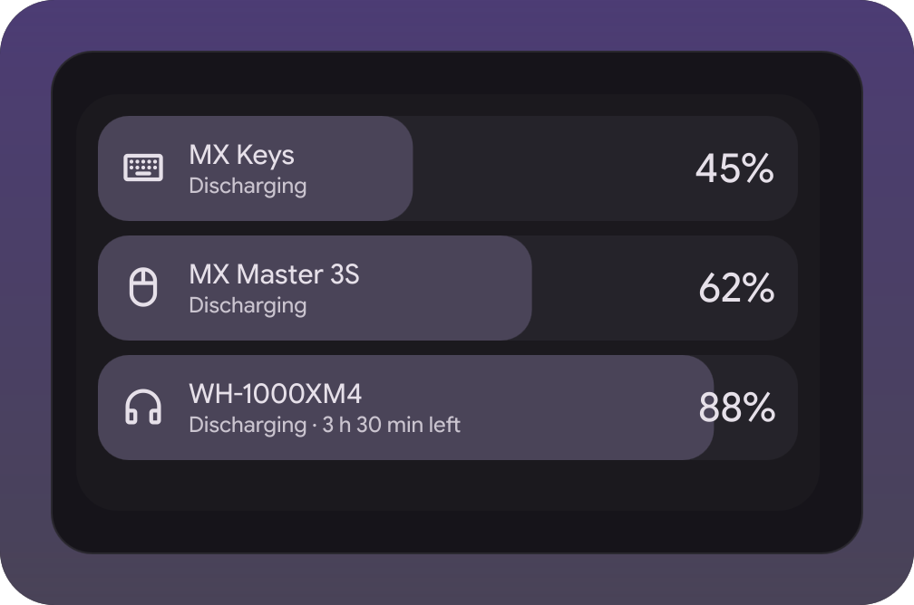

# Peripheral battery widget

Battery of mice, keyboards, headsets and whatever else the desk is full of: a
circle per device in the bar, cards in the right sidebar, a notification when one
of them runs flat. Reads UPower, so anything your system already knows about shows
up. A widget for the
[illogical-impulse extensions fork](https://github.com/Berupor/dots-hyprland).

| In the bar | In the sidebar |
|---|---|
|  |  |

Nothing in those pictures is plugged in: the scenes in `demo/` hand the views
made-up devices, which is also how the tests run.

## Install

Settings → Widgets → Install a widget, paste:

```
https://github.com/Berupor/ii-widget-peripheral-battery.git
```

Options: every device or only the emptiest one, and each of the two places it
shows up can be turned off on its own.

## Hacking

With the fork checked out next door, the scenes are both the tests and the pictures:

```sh
tests/qml-cases.sh    -x ~/.config/illogical-impulse/widgets/peripheralBattery
tests/widget-shots.sh -x ~/.config/illogical-impulse/widgets/peripheralBattery
```

`git config core.hooksPath .githooks` runs them on push. GPL-3.0.
